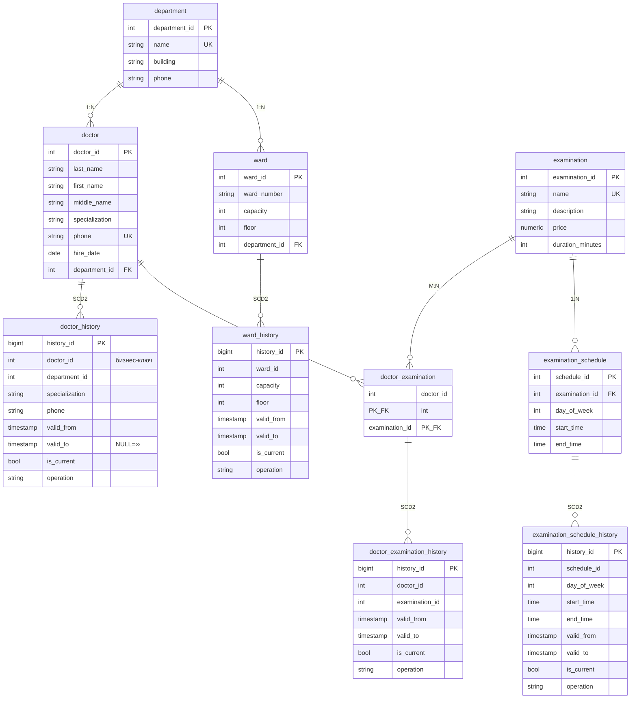

# ER «Больница» + SCD Type 2

Источник: `er_diagramma.jpg` (как в PR / задании).

## Сравнение с диаграммой

| Элемент | На диаграмме | В SQL |
|---|---|---|
| `department` | name, building, phone | ✅ |
| `ward` | ward_number, capacity, floor, department_id | ✅ |
| `doctor` | ФИО, specialization, phone UNIQUE, hire_date, department_id | ✅ |
| `examination` | name, description, price, duration_minutes | ✅ |
| `doctor_examination` | PK(doctor_id, examination_id) | ✅ |
| `examination_schedule` | day_of_week, start_time, end_time | ✅ |
| `ward_history` | ward_id, capacity, floor + SCD | ✅ только эти поля |
| `doctor_history` | doctor_id (бизнес-ключ), department_id, specialization, phone + SCD; valid_to NULL=∞ | ✅ |
| `examination_schedule_history` | schedule_id, day_of_week, start/end + SCD | ✅ |
| `doctor_examination_history` | doctor_id, examination_id + SCD | ✅ |
| История у department / examination | нет | ✅ нет |

